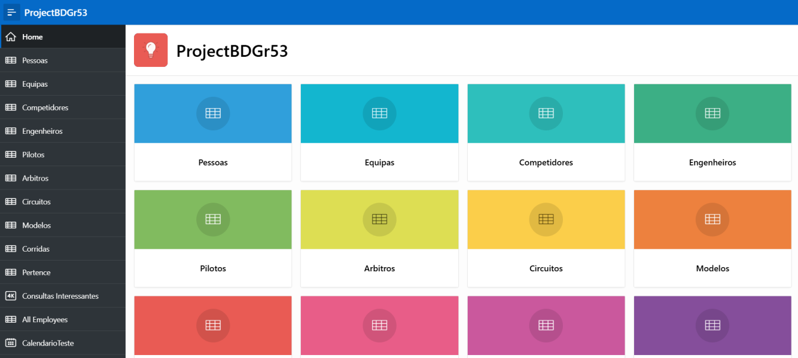
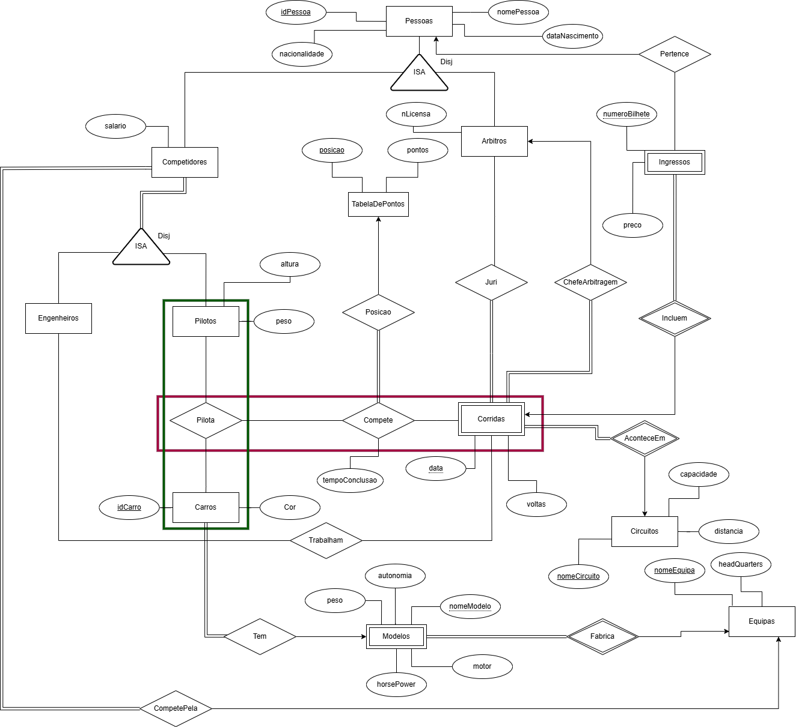
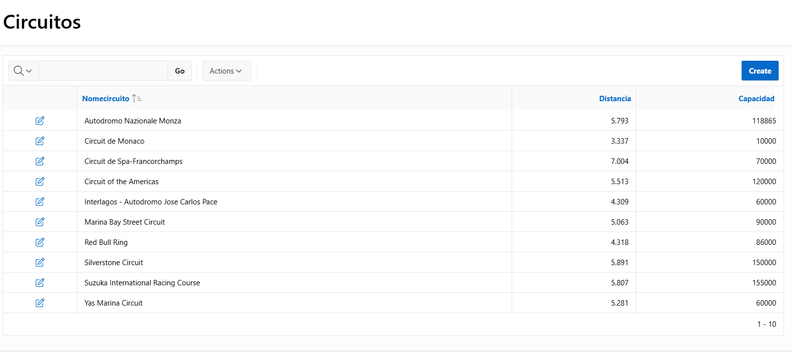
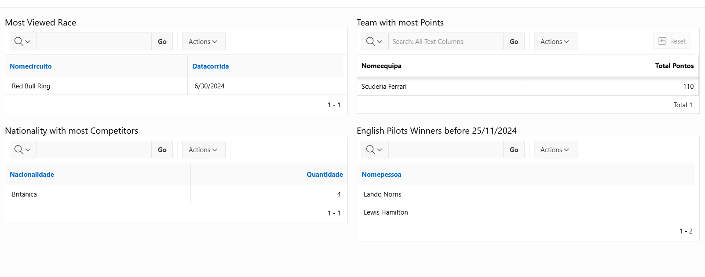

# 🏎️ Formula 1 Database — Databases

  
  
  
  

Group project of *Bases de Dados* (Databases), Computer Science degree at **NOVA School of Science and Technology (FCT NOVA)**. Each group picked its own domain and built a complete database — from the entity-relationship model to an Oracle database and a web interface. We chose **Formula 1**.

  

## About

The database manages teams, drivers, engineers, cars and their models, circuits, races and results, referees and race juries, and the tickets sold to the public.

**Data model highlights**

- **Specializations (ISA)** — a person can be a competitor (a *driver* or an *engineer*, never both) or a *referee*; the specializations are disjoint and enforced with triggers.
- **Aggregations** — a driver driving a car competes in a race, and that participation gets a finishing position and points.
- **Weak entity** — tickets only exist for a given race.

**Business rules enforced in the database** (PL/SQL triggers), for example:

- a driver can only drive a car from their own team;
- a race can't have more competitors, nor a team more drivers, than allowed;
- a race can't sell more tickets than its circuit's capacity, and staff working at a race can't buy a ticket for it;
- the points table must be complete, and the chief referee can't be removed from a jury;
- birth dates must be valid, and ids come from sequences.

**Views and queries** — all employees, who competes in each race, unsold tickets, and "interesting queries" such as the team with the most points, the most watched race, the nationality with the most competitors and British drivers who won a race before a given date.

## The model

  

## The web app (Oracle APEX)

| | |
|---|---|
|  |  |
| Every entity has a report page with search, plus forms to create and edit rows | "Interesting queries" page with the results of the views |

## Files

| File | What it is |
|---|---|
| `database.sql` | The whole schema: tables, constraints, sequences, views, triggers and a procedure (data was entered through the app) |
| `apex-app.sql` | Export of the Oracle APEX application (APEX 24.2) |
| `docs/` | Figures from our report |

To try it, run `database.sql` in an Oracle database (we used Oracle 18c) and import `apex-app.sql` in Oracle APEX (**App Builder → Import**).

## What I learned

- Modelling a real domain with entity-relationship diagrams: specializations, aggregations and weak entities
- Turning the model into a relational schema with keys and constraints
- Enforcing business rules with PL/SQL triggers, and writing views and non-trivial queries
- Building a data-driven web interface with Oracle APEX

## Authors

Group 53:

- **Miguel Carmo** ([@MCCProgrammer](https://github.com/MCCProgrammer))
- **Felipe Magno**
- **Tomás Ramos Alves** ([@Alvesss04](https://github.com/Alvesss04))

---

The assignment statement is not included in this repository, as it belongs to the course's teaching staff. This is a student project shared for portfolio purposes.
